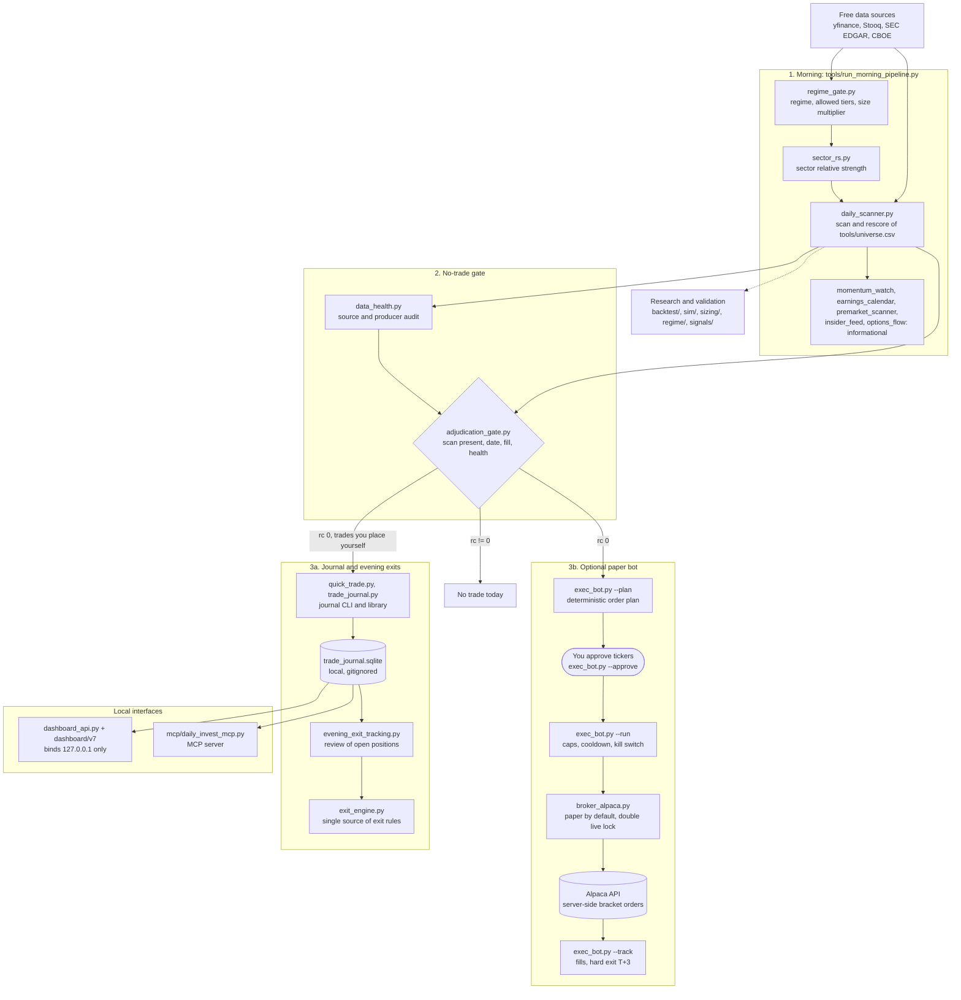

# glass-quant

**The Glass Quant: an open research pipeline for end-of-day swing trading.** Using end-of-day data, it scans a 639-ticker universe for mean-reversion setups before the next session, refuses to act on bad data, journals every trade and can paper-trade with hard limits.

> [!WARNING]
> **Experimental research software. Not financial advice.**
> This system has not made anyone rich, and it can lose money. Backtest results in this repository are hypothetical. Paper trading is the default. Live trading only works after a deliberate double unlock and is entirely at your own risk. Read [DISCLAIMER.md](DISCLAIMER.md) before you run anything.

## Contents

- [Status](#status)
- [What it does](#what-it-does)
- [Architecture](#architecture)
- [Quickstart](#quickstart)
- [Paper trading and live trading](#paper-trading-and-live-trading)
- [Main commands](#main-commands)
- [Project structure](#project-structure)
- [Running tests](#running-tests)
- [Known issues](#known-issues)
- [Contributing](#contributing)
- [Roadmap](#roadmap)
- [Background](#background)
- [License](#license)
- [Disclaimer](#disclaimer)

## Status

- **Experimental.** This grew out of a personal research setup and is shared so that people who like finance, trading, AI and code can read it, test it and make it better. It is not a product, and there is no support promise.
- **No performance claims.** This README makes no performance claims, and the project has no live track record. The research reports in the repository root contain hypothetical backtest statistics with known biases (survivorship bias, parameters chosen with hindsight, simplified costs). They are research notes, not forecasts and not advice. Much of the research in here is about how hard a real edge is to find: news sentiment, options flow, insider filings and the market put/call ratio showed no measurable edge in ablation tests, so those layers are switched off in scoring.
- **What works today:** an offline test suite (763 tests, a few seconds on Python 3.9 and 3.12), offline selftests for most tools, the daily scan and its data-quality gate, a local SQLite trade journal, a paper execution bot for Alpaca's paper API, a local dashboard and an MCP server.
- **What does not work yet:** the backtests cannot be reproduced from this repository alone (the local data lake and its builder are not included), a fresh journal has a few rough edges (see [Known issues](#known-issues)), and many docstrings, log messages and research reports are still in German.

## What it does

One loop per trading day, from data to decision to review:

1. **Regime check.** `tools/regime_gate.py` classifies the market with simple rules (VIX level, ADX of SPY, 5-day SPY move) and writes the allowed universe tiers and a size multiplier. If VIX or SPY data is missing, it classifies no regime (`status: degraded`, exit code 3), data health turns critical, and both the gate and the paper bot return no trade.
2. **Scan.** `tools/daily_scanner.py` scores every ticker in `tools/universe.csv` (US, European and Asian stocks, ETFs, commodities and crypto) for Connors-style mean-reversion setups: RSI(2, 5, 14), SMA(5, 20, 200) and ATR. The score works as a pass/fail gate with a per-ticker threshold (7.5 to 9.0), not as a ranking. Candidates are split into instruments a typical EU retail investor can buy directly and a separate watch block (futures, US ETFs without a KID, Asian local listings). An optional exclusion list removes tickers you never want to see.
3. **Gate.** `tools/data_health.py` audits the data producers. `tools/adjudication_gate.py` returns exit code 0 only if today's scan exists, matches the date, has at least 80% valid data and data health is not critical. Anything else means no trade that day.
4. **Decide.** You decide. Optionally, `tools/exec_bot.py` turns the candidates into a deterministic order plan, and nothing is sent until you approve specific tickers.
5. **Execute on paper.** Approved orders go to Alpaca's paper API as server-side bracket orders (stop and target sit at the broker), with caps on orders per day, open positions, notional, risk per trade and portfolio heat, plus a re-entry cooldown and a kill switch.
6. **Journal.** `tools/quick_trade.py` records trades in a local SQLite journal (`trade_journal.sqlite`, gitignored).
7. **Exit review.** `tools/exit_engine.py` keeps the exit rules in one place: the Connors SMA5 exit (close back at or above the 5-day average), ATR take profit, ATR stop loss, and a hard exit after 3 trading days if the trade is not up at least 1%. `tools/evening_exit_tracking.py` applies them to the open journal positions in the evening.
8. **Measure.** Research tools, backtests and simulations (bootstrap confidence intervals, Monte Carlo paths, a cost model, VaR and CVaR) check whether any of this holds up out of sample.

Design principles:

- **No LLM in the order path.** Orders only come from deterministic, tested code. AI assistants can help write code and analyze results. They never place orders.
- **Paper first.** Paper mode is the default, and the live endpoint is locked behind two independent switches.
- **Fail loud.** Documented exit codes, write-once scan files with SHA-256 manifests and a no-trade gate on degraded data, instead of silent fallbacks.
- **Free data only.** yfinance, Stooq, FRED, GDELT, SEC EDGAR, CBOE and, optionally, Reddit. The local dashboard also reads Google News RSS for the news of a single ticker. Every provider has its own terms. Website scrapers (openinsider and capitoltrades in `tools/insider_feed.py`) are opt-in.
- **Your data stays local.** Keys, journal, exports, briefings and daily outputs are gitignored.

## Architecture



Solid arrows show the daily flow. The dotted arrow means the research tools read the local scan archive (and the hypothetical backtest corpus `v6_backtest_results_v61.csv`). [`tools/README.md`](tools/README.md) maps every tool, and [`CLAUDE.md`](CLAUDE.md) describes the rules the code enforces.

## Quickstart

### Requirements

- **Python 3.9 or newer.** The test suite is verified on Python 3.9 and 3.12. The optional MCP server needs Python 3.10 or newer.
- **macOS or Linux.** The project is developed on macOS. Linux should work but is not tested yet. Windows is not supported right now: `tools/exec_bot.py` uses `fcntl`, and the scheduler scripts use launchd.
- **Internet access** for the daily pipeline (market data). Tests and selftests run offline.

### Install

```bash
git clone https://github.com/lazzzay/glass-quant.git   # or your fork
cd glass-quant
python3 -m venv .venv
source .venv/bin/activate
python3 -m pip install -r requirements.txt
python3 -m pip install -r requirements-dev.txt   # adds pytest
./run_tests.sh                                    # 763 offline tests, no keys needed
```

Optional extras (sentiment models, HMM regime, Reddit, MCP server) are in `requirements-optional.txt`. The sentiment models are downloaded from Hugging Face at runtime.

### Configure

```bash
cp tools/.env.example tools/.env                       # Alpaca PAPER keys, optional ntfy topic
cp config/blacklist.example.txt config/blacklist.txt   # optional ticker exclusion list
```

Both copies are gitignored. `tools/.env` is the only env file the code reads by itself, and only for `ALPACA_KEY_ID`, `ALPACA_SECRET_KEY` and `NTFY_TOPIC`.

Every other setting is optional and listed in [`.env.example`](.env.example). The tools read these settings from the environment, so export what you need, or keep a local copy and load it into your shell:

```bash
cp .env.example .env          # gitignored, edit it first
set -a; . ./.env; set +a      # export its values into the current shell
```

Before your first real morning run, set `SEC_USER_AGENT` to your name and email address. SEC EDGAR asks automated clients to identify themselves.

### Try it offline first

No keys and no network needed:

```bash
python3 tools/run_morning_pipeline.py --selftest
python3 tools/adjudication_gate.py --selftest
python3 tools/exit_engine.py --selftest
python3 tools/exec_bot.py --selftest      # uses a fake broker transport, sends nothing
python3 sim/risk.py --snapshot dashboard/v7/trades_snapshot.example.json --out-dir /tmp/daily-invest-risk
```

The last command computes VaR and CVaR on a synthetic 60-day equity curve.

### First real run (network)

```bash
python3 tools/run_morning_pipeline.py        # Monday to Friday; add --force on a weekend
python3 tools/adjudication_gate.py --write   # rc 0: data is good enough. Anything else: no trade.
```

Outputs land in `tools/` (for example `scan_<date>.json` and `regime_<date>.json`), in `signals/` and in `tools/_logs/`. All of them are gitignored.

### Start a journal

```bash
python3 tools/trade_journal.py init
python3 tools/migrations/002_v72_trade_entry.py --apply
python3 tools/migrations/003_v74_discipline.py --apply
python3 tools/migrations/004_disc_book_source.py --apply
python3 tools/quick_trade.py buy AAA 1000 --date 2099-01-05 --source discretionary
python3 tools/quick_trade.py status
```

`init` creates `trade_journal.sqlite` in the repository root and imports 440 hypothetical backtest trades from `v6_backtest_results_v61.csv` (tagged `source=backtest`) for the research tools. Never edit the journal with raw SQL. Please read [Known issues](#known-issues) first: a fresh journal currently has three rough edges.

## Paper trading and live trading

### Paper trading (default)

1. Create a paper trading account at [Alpaca](https://alpaca.markets), switch the dashboard to **Paper** and generate API keys. Treat the keys like a password: anyone who has them can trade that account. Use paper keys, use a separate account for the bot, keep `tools/.env` private (`chmod 600 tools/.env`), regenerate the keys after any leak and never put live keys into tests.
2. Paste them into `tools/.env` as `ALPACA_KEY_ID` and `ALPACA_SECRET_KEY`.
3. Check the setup:

   ```bash
   python3 tools/broker_alpaca.py --selftest   # offline
   python3 tools/broker_alpaca.py --probe      # network: checks your keys against the paper endpoint
   ```

4. Run the daily flow after the morning pipeline and a passing gate (`adjudication_gate.py --write`, rc 0):

   ```bash
   python3 tools/exec_bot.py --plan                    # build the order plan, sends nothing
   python3 tools/exec_bot.py --approve --tickers AAA   # your explicit approval, per ticker
   python3 tools/exec_bot.py --run                     # submit approved bracket orders (paper)
   python3 tools/exec_bot.py --track                   # evening: fills, hard exit T+3
   python3 tools/exec_bot.py --reconcile               # bot ledger vs broker positions
   python3 tools/exec_bot.py --status                  # ledger summary, gate progress, kill state
   python3 tools/exec_bot.py --kill                    # emergency: close positions, cancel orders, then block
   ```

Limits live in [`tools/exec_bot_config.json`](tools/exec_bot_config.json). The shipped example allows up to 3 orders per day, 3 positions, 1,000 USD per trade, 50 USD risk per trade and 150 USD portfolio heat. The config is validated on every start, and a broken or out-of-range file stops the bot instead of falling back to defaults. After `--kill`, the bot stays blocked until you delete `tools/EXEC_BOT_KILL`. Let only the bot trade the bot's account. A push notification is never a reason to act: check with `--status` or `--reconcile` first.

### Live trading (off by default)

> [!CAUTION]
> **Live mode sends real orders with real money. You can lose part or all of the money in that account, and losses can happen fast. This software is not financial advice and comes without any warranty. You alone are responsible for every order your setup sends. Run paper trading first, read the code that will place your orders, and only risk money you can afford to lose.**

Live keys alone do not switch the bot to live. The broker adapter refuses any non-paper endpoint unless all four of these are true:

1. `tools/.env` (or your environment) holds API keys from your **live** Alpaca account.
2. In `tools/exec_bot_config.json`, `base_url` points to Alpaca's live endpoint `https://api.alpaca.markets`. Set `mode` to `"live"` as well, so the file says what it does.
3. In the same file, `allow_live` is `true`.
4. The shell that runs the bot exports `EXEC_BOT_ALLOW_LIVE=1`. This variable is read from the environment only, never from `tools/.env`.

If the endpoint is live but one of the two unlocks is missing, the adapter raises a `LiveLockError` and sends nothing. While live mode is configured, every run prints a large warning to the console. Exposure caps, the approval step, the re-entry cooldown and the kill switch stay active. To go back to paper, set `base_url` to `https://paper-api.alpaca.markets`, set `allow_live` to `false`, unset `EXEC_BOT_ALLOW_LIVE` and use paper keys.

## Main commands

All commands run from the repository root. "Network" means the command fetches data or talks to an external service.

### Daily loop

| Command | What it does | Network |
|---|---|---|
| `python3 tools/run_morning_pipeline.py [--force]` | Morning orchestrator: regime, sector RS, scan, rescore, momentum watch, earnings, premarket, then the informational insider and options flow steps. Fail-soft; the exit code is the number of failed steps. | yes |
| `python3 tools/daily_scanner.py --date YYYY-MM-DD` | Universe scan with environment and fill guards (also run by the pipeline) | yes |
| `python3 tools/data_health.py --date YYYY-MM-DD` | Health report over sources and producers | no |
| `python3 tools/adjudication_gate.py [--date YYYY-MM-DD] [--write]` | No-trade gate. rc 0: trade allowed. rc 2: scan missing. rc 3: fill too low. rc 4: data health critical. rc 5: stale scan. | no |
| `python3 tools/evening_exit_tracking.py [--write]` | Exit review of open journal positions. rc 3 means the journal is unreadable, which is never the same as "no positions". | yes |
| `python3 tools/catalyst_calendar.py` | Weekly earnings and macro calendar | yes |

### Journal

| Command | What it does | Network |
|---|---|---|
| `python3 tools/quick_trade.py <command>` | Journal CLI with `buy`, `sell`, `status`, `summary`, `recompute`, `set-levels` and `export` | no |
| `python3 tools/trade_journal.py <command>` | Journal library and CLI with `init`, `add`, `close`, `equity`, `list`, `stats` and `cohort` | no |

### Paper bot

| Command | What it does | Network |
|---|---|---|
| `python3 tools/exec_bot.py --plan`, `--approve --tickers A,B [--by NAME]`, `--run`, `--track`, `--reconcile`, `--status`, `--gate-report`, `--kill` | Paper execution bot (see above) | yes, needs keys |
| `python3 tools/exec_bot.py --selftest` | Offline selftest with a fake broker | no |
| `python3 tools/broker_alpaca.py --selftest` or `--probe` | Adapter selftest, or a key check against the paper endpoint | `--probe` only |

### Interfaces

| Command | What it does | Network |
|---|---|---|
| `python3 tools/dashboard_api.py`, then open `dashboard/v7/index.html` | Local cockpit API on 127.0.0.1:5757. Never expose it beyond localhost. See [`dashboard/v7/README.md`](dashboard/v7/README.md). | some endpoints fetch prices |
| `python3 mcp/daily_invest_mcp.py` | MCP server for MCP-capable AI clients (Python 3.10+). See [`mcp/README.md`](mcp/README.md). | some tools fetch prices |

### Scheduling (macOS)

| Command | What it does | Network |
|---|---|---|
| `bash tools/install_launchd_crons.sh --dry-run` | Writes the launchd plists to `tools/_launchd_preview/` (gitignored) and prints them. A dry run never touches `~/Library/LaunchAgents` and loads nothing. Run without the flag to install (the jobs then also start after every login), or with `--uninstall` to remove them. `--python PATH` pins the interpreter the jobs use (default: the `python3` on your `PATH`). Jobs: news (Mon to Fri 06:30), morning pipeline (Mon to Fri 08:00 plus catch-up runs), gatekeeper (Mon 09:45), catalyst calendar (Sun 20:00). | no |
| `python3 tools/verify_launchd_crons.py [--selftest]` | Checks that the jobs are registered (`launchctl list`) and produced today's files. Reads local state only. | no |

### Research and simulation

| Command | What it does | Network |
|---|---|---|
| `python3 tools/<research tool>.py --selftest` | Offline selftests, for example `entry_score_edge`, `entry_filter_robustness`, `exit_attribution`, `regime_cell_edge_map`, `tier_rule_counterfactual`, `wf_replay` | no |
| `python3 tools/build_ablation_panel.py --start YYYY-MM-DD --end YYYY-MM-DD --out panel.json`, then `python3 tools/layer_ablation.py --panel panel.json` | Layer ablation: which scoring layer carries an edge? Needs a local scan archive. See `H2-Layer-Ablation-Runbook.md`. | panel build only |
| `python3 sim/risk.py --snapshot <file> --out-dir <dir>` | VaR and CVaR on an equity snapshot | no, if the snapshot has 30+ days |
| `python3 backtest/backtest_engine.py` (and the other scripts in `backtest/`) | Research backtests. They need a local `data_lake/` that is not included. | no, local data |
| `python3 credit_ampel_v31.py [--test]` | Credit stress score from FRED and Yahoo data | yes, except `--test` |
| `python3 tools/build_universe.py [--out PATH] [--force]` | Generates a universe CSV (default `tools/universe.generated.csv`). Never overwrites the curated `tools/universe.csv` without `--force`. | no |
| `python3 tools/user_blacklist.py [--selftest]` | Shows the effective ticker exclusion list | no |

## Project structure

| Path | What is inside |
|---|---|
| `tools/` | Pipeline, paper bot, journal, libraries and research tools. Map: [`tools/README.md`](tools/README.md) |
| `tools/universe.csv` | Curated 639-ticker universe with tier, asset class, per-ticker ATR multipliers and score thresholds |
| `tools/exec_bot_config.json` | Paper bot limits (paper mode, live locked) |
| `tools/migrations/` | Journal schema migrations (`--dry-run`, `--apply`, `--verify`, `--test`) |
| `tools/.env.example` | Template for `tools/.env` (broker keys, ntfy topic) |
| `config/` | `blacklist.example.txt`, the template for the optional exclusion list |
| `dashboard/` | Local cockpit (`v7/index.html`), a synthetic `trades_snapshot.example.json` and `state.example.json`, the template for the gitignored runtime file `state.json` |
| `mcp/` | MCP server and its setup guide |
| `backtest/` | Research backtests (need a local `data_lake/`, not included) |
| `sim/` | Bootstrap confidence intervals, Monte Carlo paths, cost model, VaR and CVaR |
| `sizing/` | Optimal f and a shadow sizing runner |
| `regime/` | A 3-state HMM regime stub (needs `hmmlearn`) |
| `signals/` | Shadow scanners (momentum breakout, post-earnings drift, Reddit trending). Run artifacts here are gitignored. |
| `tests/` | 763 offline pytest tests |
| `tickets/` | Design ticket for a fuller HMM regime classifier |
| Root `*.md` files | Research reports and specs, mostly in German. All results in them are hypothetical. |
| `v6_backtest_results_v61.csv` | Hypothetical backtest corpus (440 trades) used by the research tools |
| `credit_ampel_v31.py` | Credit stress overlay |
| `CLAUDE.md` | Orientation for AI coding agents and contributors |
| `run_tests.sh`, `requirements*.txt`, `.env.example` | Test runner, dependencies, environment reference |

## Running tests

```bash
./run_tests.sh                            # whole suite, offline
./run_tests.sh -k journal -v              # extra arguments go to pytest
python3 -m pytest tests/ -q               # the same without the wrapper
python3 tools/exit_engine.py --selftest   # many tools also ship an offline selftest
```

Tests must stay offline: no network, no broker calls, no orders and no writes outside a temporary directory. These commands do touch the network and must never run in CI: `tools/broker_alpaca.py --probe`, `tools/alpaca_data.py --probe` and `--compare`, `tools/data_source_orchestrator.py --selftest` (a smoke test against yfinance and Stooq), `tools/finbert_scorer.py --selftest` and `tools/findpo_scorer.py --selftest` (model downloads), `tools/options_flow.py --selftest`, `tools/news_sentiment_fetch.py --selftest`, `tools/notify.py --test`, and every `tools/exec_bot.py` mode except `--selftest`. `tools/verify_launchd_crons.py` without `--selftest` needs no network, but it reads your real `launchctl` state, so keep it out of CI as well.

## Known issues

Honest list of what is rough right now. Each item links to a starter task in [GOOD_FIRST_ISSUES.md](GOOD_FIRST_ISSUES.md).

- **Backtest rows look like open positions.** `trade_journal.py init` imports the 440 hypothetical backtest trades without an exit date, so `quick_trade.py status`, the evening exit review and the MCP journal status list them as open positions. There is no flag to skip the import yet. ([#1](GOOD_FIRST_ISSUES.md#1-do-not-treat-imported-backtest-trades-as-open-positions))
- **Missing columns on a fresh journal.** `quick_trade.py buy` with `--entry-price`, `--stop`, `--target` or `--side`, and `quick_trade.py set-levels`, fail with `table trades has no column named stop`. These columns are only created by the dashboard API. Workaround: start `python3 tools/dashboard_api.py` once and run `curl -X POST http://127.0.0.1:5757/state/sync`. ([#2](GOOD_FIRST_ISSUES.md#2-give-the-journal-schema-one-owner))
- **`TRADE_JOURNAL_DB` is only honored by `tools/trade_journal.py`.** Most other tools use `<repo>/trade_journal.sqlite` (a few accept `--db`). Keep the journal at the default path for now. ([#3](GOOD_FIRST_ISSUES.md#3-honor-trade_journal_db-everywhere))
- **Dashboard run buttons.** "Morning scan" runs `tools/daily_scanner.py` instead of the full morning pipeline, and "Evening tracking" runs `tools/evening_exit_tracking.py` without `--write`. ([#8](GOOD_FIRST_ISSUES.md#8-point-the-dashboard-run-buttons-at-the-real-entry-points))
- **Backtests are not reproducible from this repository alone.** `backtest/`, the HMM regime stub and the price lookup of the tax tool need a local `data_lake/` (layout in `Data-Lake-V1-Spec.md`), and `tools/lake_migrate.py` needs a schema file that is not included.
- **Language.** Many docstrings, CLI help texts, log messages and the research reports are in German. ([#9](GOOD_FIRST_ISSUES.md#9-translate-cli-help-and-console-messages-to-english), [#10](GOOD_FIRST_ISSUES.md#10-translate-the-dashboard-docs-to-english))
- **Dashboard API trust model.** No authentication; it relies on binding to 127.0.0.1 and an Origin and Host allowlist that also accepts the `null` origin of `file://` pages. See [SECURITY.md](SECURITY.md).

## Contributing

Contributions are welcome, from typo fixes to new research. Start with [GOOD_FIRST_ISSUES.md](GOOD_FIRST_ISSUES.md), read [CONTRIBUTING.md](CONTRIBUTING.md) and follow the [Code of Conduct](CODE_OF_CONDUCT.md). Three rules matter most:

1. Tests stay offline.
2. No API keys and no personal trading data in commits, issues or logs.
3. No LLM in the order path.

Security problems go through [SECURITY.md](SECURITY.md), not through public issues.

## Roadmap

Concrete starter tasks are in [GOOD_FIRST_ISSUES.md](GOOD_FIRST_ISSUES.md). Bigger directions:

- Continuous integration that runs the offline suite on macOS and Linux and on several Python versions.
- A clean fresh install: one owner for the journal schema, one journal path, no backtest rows among open positions.
- English everywhere: docstrings, CLI help, logs and the research reports.
- A small, terms-respecting data lake builder, so the backtests can be reproduced (layout in `Data-Lake-V1-Spec.md`).
- A portable lock in the paper bot, so it can run on Windows.
- Dashboard hardening: a per-session token instead of trusting the `null` origin, and a Subresource Integrity hash for Chart.js.
- MCP ideas from [`mcp/README.md`](mcp/README.md): a search over SEC filings, separate analysis tools per topic and a market put/call tool.

## Background

glass-quant started as Louis Lazay's attempt to trade more systematically and to measure honestly whether it works. It was built in public with Claude Code, and it was called Daily Invest internally (you will still find that name in a few places in the code).

The research behind it, including 29 years of backtests measured against the S&P 500, is written up in the paper *Der gläserne Quant* (German): https://www.augh-consulting.de/der-glaeserne-quant. The honest result: no miracle returns. Read the paper for the details.

Follow the journey on Instagram: [@louis.lazay](https://www.instagram.com/louis.lazay/)

## License

Copyright (C) 2026 The glass-quant contributors.

glass-quant is free software: you can redistribute it and/or modify it under the terms of the [GNU Affero General Public License](LICENSE) as published by the Free Software Foundation, either version 3 of the License, or (at your option) any later version (SPDX: `AGPL-3.0-or-later`). You may use, study, change and share it. If you distribute a modified version, or let other people use a modified version over a network, you must make your source code available to them under the same license. The full terms are in [LICENSE](LICENSE), and the copyright notice is in [NOTICE](NOTICE).

## Disclaimer

This project is for education and research. It is not financial, investment or tax advice, and nothing in it is a recommendation to buy or sell anything. You can lose some or all of your money, and with margin or leveraged products even more than you put in. Past and backtest results do not predict future results. Live trading is entirely at your own risk and responsibility. The software comes without any warranty (AGPL-3.0, sections 15 and 16). Full text in English and German: [DISCLAIMER.md](DISCLAIMER.md).
